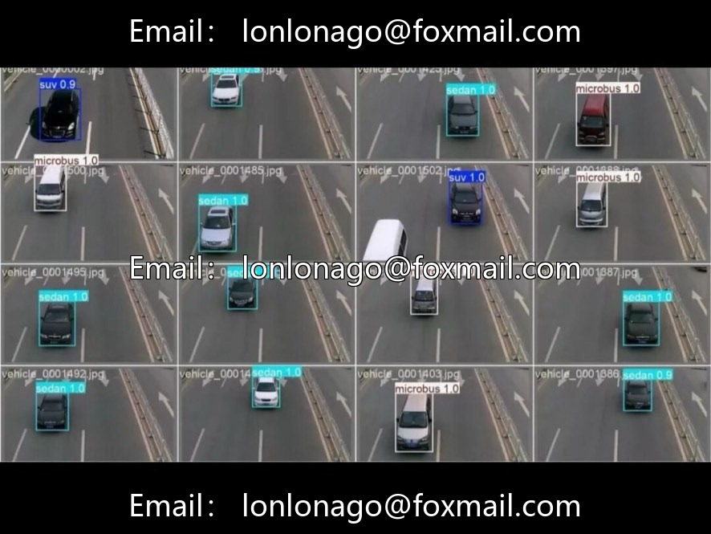
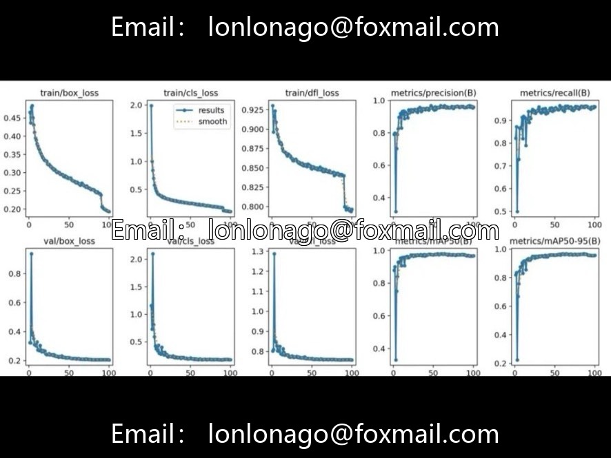
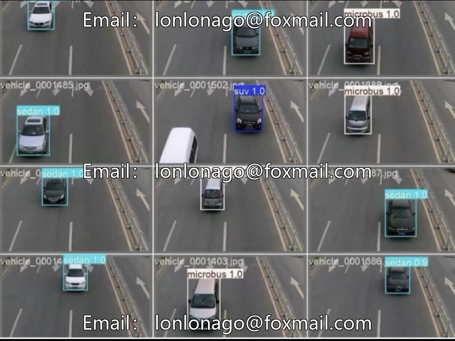

# Vehicle Model Identification Detection Dataset (Vehicle Counting/SUV/Bakery Truck Detection)

## Body

Vehicle Model Identification Detection Dataset (Vehicle Counting/SUV/Bed Truck Detection
Project Number: Inferred as Issue 10xxx)

The dataset consists of 9,800 real road scene images covering 6 common vehicle types, suitable for traffic flow statistics, parking lot management, autonomous driving perception and other applications.

Covering 6 core vehicle types on the road
SUV - Sport utility vehicle
Sedan - Sedans
Microbus - Buses
Minivan - Minivans
Truck - Trucks
Bus - Buses

Task Type: Object Detection
Total Images: 9,800
Number of Categories: 6
Annotation Format: YOLO (.txt) with normalized coordinates
Data Sources: Real road surveillance, vehicle dashcams, street panoramas, etc.
Scene Features: Multi-angle, multi-lighting, varying occlusion levels, closely aligned with real-world applications

Application Directions: Autonomous driving, intelligent transportation, parking lot management, auto insurance claims, smart cities, etc.

The data volume is sufficient, suitable for training high-precision vehicle detection models, and can be directly used as baseline data in traffic scenarios. Balanced categories, it is recommended to pay attention to the distribution of samples in various categories during training. If necessary, perform category weighting or data augmentation to optimize the performance of minority classes. Can be combined with vehicle counting and tracking algorithms (such as ByteTrack), to achieve real-time traffic flow statistics and trajectory analysis in video streams. Suitable for training data of intelligent transportation systems (ITS) core perception modules, supporting export in ONNX/TensorRT format for edge deployment.

Virtual materials, once sold, are non-refundable.
Interested friends, click "I want" to proceed.

## Images

## Payment

Here is a pay link on Stripe ( https://buy.stripe.com/3cs8yP7sY87d0vu9AB ). Please contact me lonlonago@foxmail.com after funding $89, and I will send you a complete data files , thank you!

